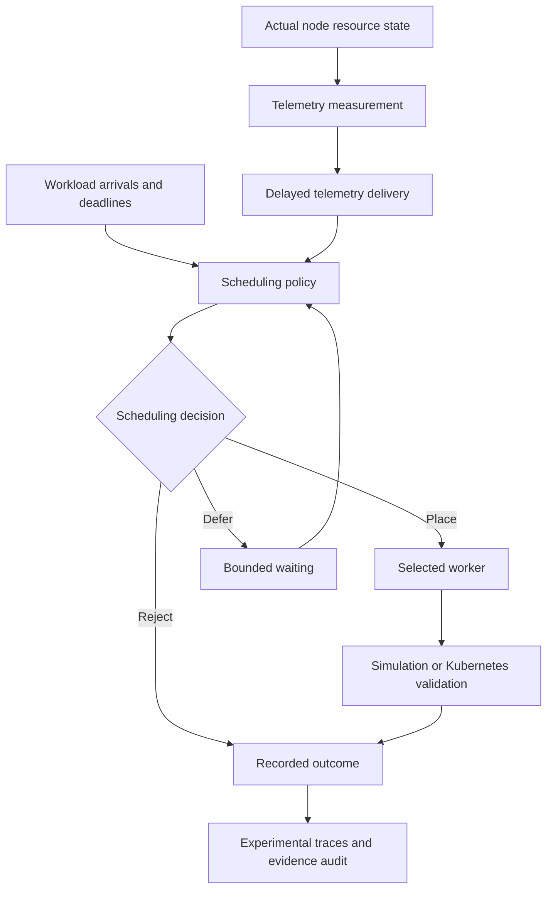
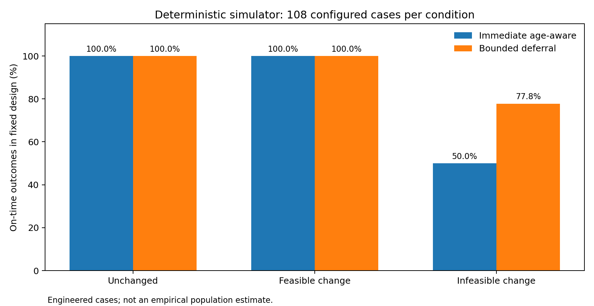
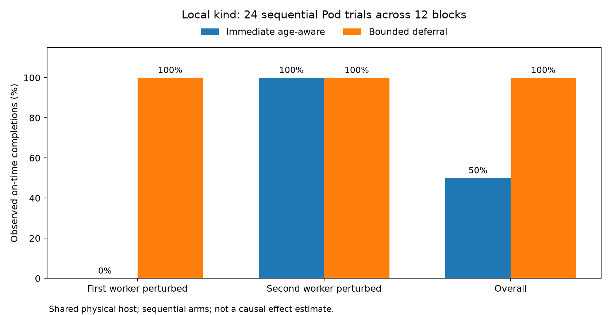

# EdgePilot v2 — Deadline-Aware Scheduling Under Stale Telemetry

**A reproducible experimental framework for studying the trade-off between telemetry freshness, workload placement feasibility, and deadline constraints.**

[](https://github.com/Sarb008/edgepilot/releases/tag/v2.0.0-research)


## Overview

Distributed scheduling decisions frequently depend on resource observations that may already be outdated when a workload arrives.

Immediately placing a workload using stale telemetry can select a worker that no longer has sufficient schedulable capacity. Waiting for fresher information may prevent such a decision, but consumes part of the workload's available deadline budget.

EdgePilot v2 investigates this information–latency trade-off through deterministic simulation and controlled Kubernetes experiments.

### Research Question

> Under what conditions does waiting for fresher resource telemetry improve deadline-aware workload placement, despite consuming part of the available deadline?

The project evaluates when bounded waiting is beneficial, when it provides no additional value, and when it can be harmful.

## Research Contributions

- A deterministic discrete-event scheduling simulator separating actual resource state, telemetry measurement time, and telemetry delivery time.
- Four scheduling strategies: greedy, age-penalized, bounded deferral, and uncertainty-aware admission.
- Controlled telemetry delays, missing observations, capacity changes, and reliability disruptions.
- A fixed 324-case synthetic sensitivity matrix comprising 648 policy runs.
- Controlled Kubernetes CPU-request feasibility experiments comprising 24 sequential Pod trials across 12 worker-balanced blocks.
- Matched-input decision audits and worker-selection tie-breaking analysis.
- Automated evidence auditing, deterministic replay, regression testing, and reproducibility documentation.

The contribution is an exploratory experimental study and reference implementation, not a claim of a novel scheduling algorithm or production-ready Kubernetes scheduler.

## System Architecture



The scheduling policy receives only observations that have already been delivered. Actual resource state is maintained separately for execution and evaluation.

## Scheduling Strategies

| Strategy | Description |
|---|---|
| Greedy | Immediately selects a worker using observed available CPU capacity. |
| Age-penalized | Incorporates telemetry age into immediate worker selection. |
| Bounded deferral | Allows limited waiting for fresher observations within the workload's remaining deadline budget. |
| Uncertainty-aware | Accounts for uncertainty in observed resource availability when making admission decisions. |

The final primary evaluation compares immediate age-aware placement against bounded deferral.

Bounded waiting is constrained by the remaining time available for dispatch, startup, and execution.

A successful defer-and-place outcome requires:

```text
waiting + dispatch overhead + startup + execution
    <= remaining deadline budget
```

Waiting is useful only if informative telemetry becomes available before that budget is exhausted.

## Experimental Results

### 1. Deterministic Simulation

The final synthetic study contains 324 matched cases and 648 policy runs.

Both policies receive the same prescribed initial observations and external event schedules within each matched case.

| Capacity-change condition | Cases | Immediate age-aware | Bounded deferral |
|---|---:|---:|---:|
| Unchanged | 108 | 108/108 | 108/108 |
| Changed, remains feasible | 108 | 108/108 | 108/108 |
| Changed, becomes infeasible | 108 | 54/108 | 84/108 |
| Total | 324 | 270/324 | 300/324 |



In the engineered infeasible-capacity scenarios, bounded deferral improved on-time completion by 30 of 108 configured cases.

In the unchanged and still-feasible controls, waiting provided no additional on-time completions and introduced extra delay.

Earlier reliability experiments also identified disruption scenarios in which waiting was harmful.

These are deterministic configured cases, not independently sampled production workloads.

### 2. Controlled Kubernetes Validation

The Kubernetes evaluation uses a local kind cluster with one control-plane node and two Docker-backed workers sharing one physical host.

The experiment introduces a controlled CPU-request reservation on a prescribed worker and evaluates whether each policy selects a feasible placement using its available observations.

| Worker perturbation | Blocks | Immediate age-aware | Bounded deferral |
|---|---:|---:|---:|
| First worker | 6 | 0/6 | 6/6 |
| Second worker | 6 | 6/6 | 6/6 |
| Combined | 12 | 6/12 | 12/12 |



Bounded deferral introduced approximately 1.863 seconds of intentional waiting on average.

All six observed differences occurred when the lexically first worker was perturbed. This demonstrates the importance of deterministic worker selection and tie-breaking.

The results are descriptive and configuration-specific. They do not establish a general causal performance improvement.

## Implementation

```text
edgepilot/
├── research/
│   ├── models.py
│   ├── policies.py
│   ├── baselines.py
│   ├── simulator.py
│   ├── advanced.py
│   ├── reliability.py
│   ├── voi_study.py
│   ├── phase2_sensitivity.py
│   ├── kube_validation.py
│   ├── kube_wait_value.py
│   ├── phase2_real_report.py
│   ├── release_audit.py
│   └── final_figures.py
├── tests/
├── configs/
├── docs/
│   └── research-v2/
├── RESEARCH_CLAIMS.md
└── pyproject.toml
```

### Principal Components

| Component | Responsibility |
|---|---|
| `models.py` | Validated workload, resource-state, and timestamped telemetry models |
| `policies.py` | Scheduling decision interface and core policies |
| `baselines.py` | Additional scheduling comparison strategies |
| `simulator.py` | Deterministic event-driven simulation |
| `advanced.py` | Telemetry impairments and event-driven wakeups |
| `reliability.py` | Reliability and adverse-condition modeling |
| `voi_study.py` | Matched-input value-of-information experiments |
| `phase2_sensitivity.py` | Fixed synthetic sensitivity evaluation |
| `kube_validation.py` | Kubernetes inventory and validation infrastructure |
| `kube_wait_value.py` | Controlled live Kubernetes waiting-value experiments |
| `phase2_real_report.py` | Aggregation of recorded Kubernetes evidence |
| `release_audit.py` | Offline reproduction and evidence-integrity verification |
| `final_figures.py` | Generation of research figures from preserved evidence |

## Getting Started

### Requirements

- Python 3.11 or later
- Git
- pytest and matplotlib for testing and visualization

Docker, kind, and kubectl are required only for live Kubernetes validation.

### Installation

```bash
git clone --branch research-v2 https://github.com/Sarb008/edgepilot.git
cd edgepilot

python -m venv .venv
```

Activate the virtual environment.

Windows PowerShell:

```powershell
.\.venv\Scripts\Activate.ps1
```

Linux or macOS:

```bash
source .venv/bin/activate
```

Install the project and development dependencies:

```bash
python -m pip install -e ".[dev]"
```

### Run Automated Tests

```bash
python -m pytest -q
```

The final research release reports 530 passing automated tests.

### Run the Synthetic Evaluation

```bash
python -m research.phase2_sensitivity --output research_outputs/reproduction_01
```

Use a new output directory for each execution. The experimental tooling intentionally refuses to overwrite existing evidence.

### Reproduce the Research Evidence

See the [reproducibility guide](docs/research-v2/REPRODUCIBILITY.md) for exact commands, experimental configuration, saved evidence requirements, and audit procedures.

The full offline audit requires the preserved original experimental evidence directories. These are intentionally excluded from Git and must be supplied separately.

Live Kubernetes experiments are explicitly opt-in and restricted to the designated validation environment.

## Research Documentation

| Resource | Description |
|---|---|
| [Research manuscript (PDF)](docs/research-v2/EdgePilot_v2_Research_Draft.pdf) | Methodology, findings, discussion, and limitations |
| [Research manuscript source](docs/research-v2/PAPER_DRAFT.md) | Markdown manuscript |
| [Research overview](docs/research-v2/README_RESEARCH_V2.md) | Detailed research implementation overview |
| [Reproducibility guide](docs/research-v2/REPRODUCIBILITY.md) | Experimental commands and evidence requirements |
| [Research claims ledger](RESEARCH_CLAIMS.md) | Supported claims and interpretation boundaries |
| [Demonstration guide](docs/research-v2/DEMO_SCRIPT.md) | Technical demonstration and explanation |
| [Research release](https://github.com/Sarb008/edgepilot/releases/tag/v2.0.0-research) | Frozen release and manuscript |

## Limitations

- The Kubernetes workers share a single physical host.
- Live policy trials were sequential rather than simultaneous.
- CPU-request feasibility was evaluated rather than actual compute saturation.
- Worker identity and deterministic tie-breaking influenced observed outcomes.
- Synthetic scenarios were constructed rather than sampled from production workloads.
- Kubernetes placement uses the default scheduler with node selection; EdgePilot is not a replacement scheduler.
- The work does not establish broad statistical significance, general causal superiority, or production-scale performance.
- Research novelty requires further literature review and expert evaluation.

## Conclusion

Bounded deferral can improve deadline-aware placement when fresher telemetry reveals an otherwise infeasible scheduling decision and arrives within the remaining execution budget.

When telemetry provides no useful new information, waiting introduces additional latency without improving on-time completion. Under some disruption conditions, waiting can also be harmful.

EdgePilot v2 provides a reproducible platform for investigating these trade-offs under explicitly controlled conditions.

## Project Status

- **Research release:** v2.0.0-research
- **Release date:** November 12, 2026
- **Status:** Completed exploratory research implementation.

The research manuscript is publicly available but has not been peer reviewed or accepted for publication.

## Original EdgePilot v1

The original project investigated CPU/memory pressure and short-term resource trends in Kubernetes workload-placement recommendations.

Its documentation and experimental artifacts are preserved for historical reference.

[Read the original EdgePilot v1 documentation](docs/README_V1.md)
