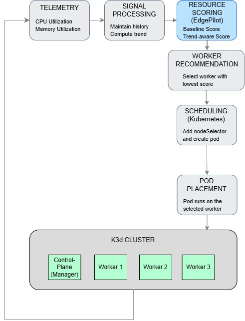
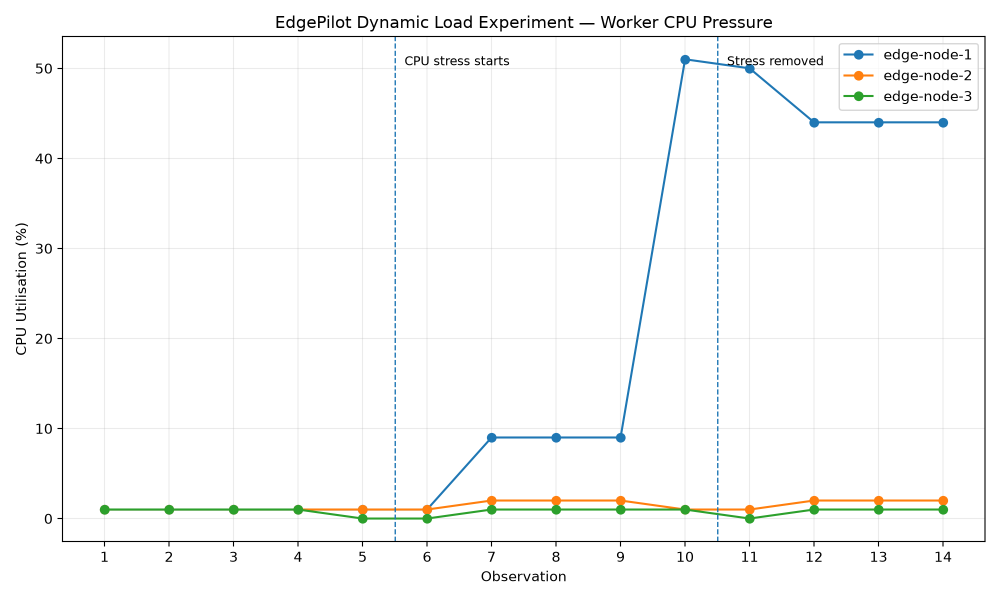
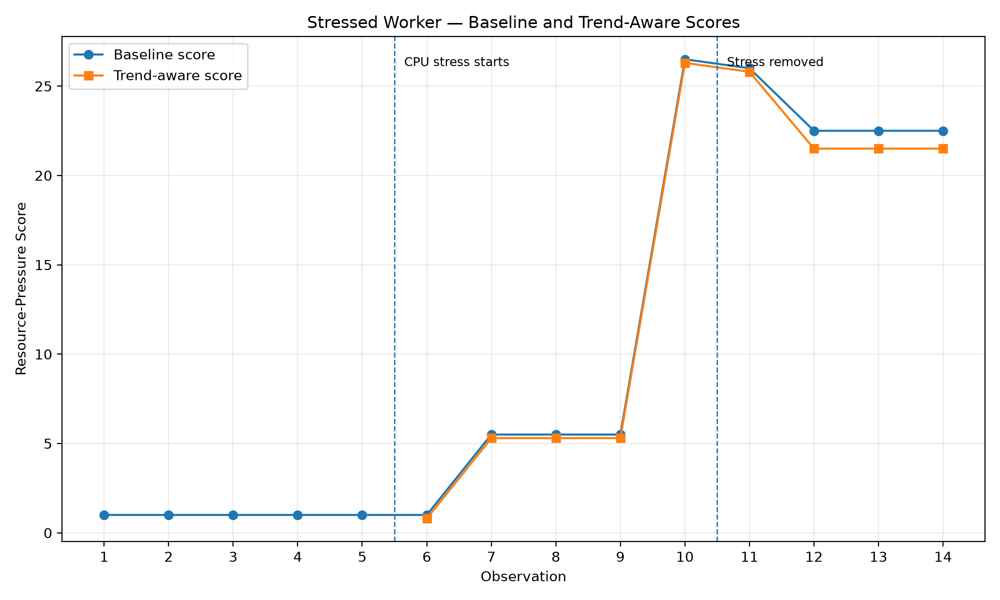
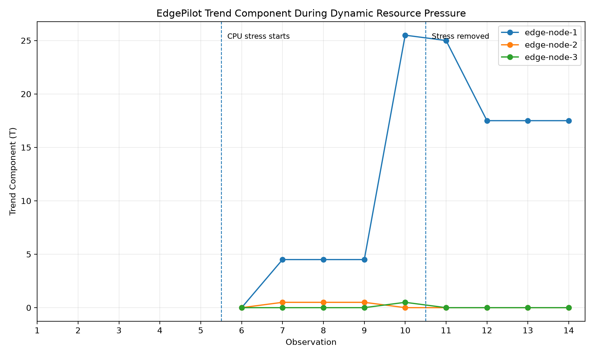
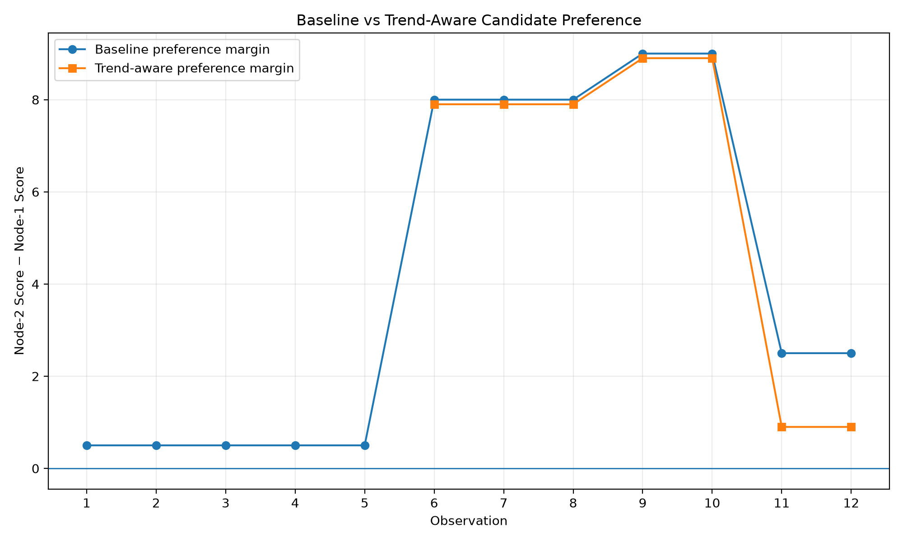
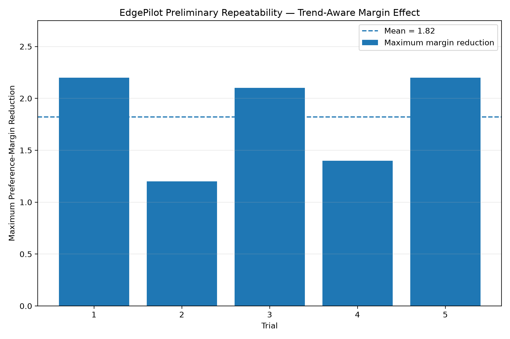

# EdgePilot v1 - Historical Project Documentation

> **Historical documentation:** This document describes the original EdgePilot prototype and its preliminary experiments. For the current deadline-aware stale-telemetry research framework, see [EdgePilot v2](../README.md).


**A Lightweight Reliability-Aware Scheduling Extension for Kubernetes Edge Clusters**

EdgePilot is an experimental Kubernetes scheduling extension that investigates whether lightweight, interpretable resource-pressure heuristics can provide useful workload-placement recommendations in resource-constrained edge environments.

Rather than replacing the Kubernetes scheduler, EdgePilot operates externally. It collects live worker-node metrics, computes resource-pressure scores, selects a preferred worker, and can inject that selection into a workload using a Kubernetes `nodeSelector`. Kubernetes remains responsible for final scheduling, binding, and workload lifecycle management.

The project also evaluates whether incorporating short-term resource trends provides additional information beyond a current-state CPU/memory heuristic.

---

## 1. Research Question

> Can a lightweight, interpretable resource-pressure heuristic provide useful scheduling recommendations for Kubernetes edge clusters, and what additional value does short-term trend awareness offer?

The study compares:

1. a **baseline current-pressure heuristic**, and
2. a **trend-aware heuristic** that additionally considers recent increases in CPU and memory pressure.

The objective is not to claim an optimal scheduler, but to experimentally study whether simple and explainable signals can provide useful scheduling guidance.

---

## 2. Architecture



EdgePilot follows a simple monitoring and placement workflow:

1. CPU and memory utilization are collected from the Kubernetes worker nodes.
2. EdgePilot maintains recent observations and calculates the short-term resource trend.
3. The baseline and trend-aware resource-pressure scores are calculated.
4. The worker with the lowest score is recommended.
5. EdgePilot adds the selected worker through a `nodeSelector`.
6. Kubernetes performs the final scheduling and pod placement.

The current experimental cluster contains one control-plane node and three worker nodes.

---

## 3. Experimental Environment

The prototype was evaluated using a k3d Kubernetes cluster running on a Google Cloud virtual machine.

### Host Environment

- Ubuntu 24.04 LTS
- Google Cloud VM
- 2 vCPUs
- 8 GB RAM
- Docker
- k3d
- kubectl
- Kubernetes Metrics Server

### Kubernetes Topology

The cluster contains:

- 1 control-plane node
- 3 worker nodes

The workers are labelled as:

```text
edge-node-1 -> k3d-edgepilot-agent-0
edge-node-2 -> k3d-edgepilot-agent-1
edge-node-3 -> k3d-edgepilot-agent-2
```

using the Kubernetes label `edgepilot.io/node`.

### Experimental Limitation

The k3d nodes are logical Kubernetes nodes implemented as containers and share the resources of a single cloud VM.

Therefore, this environment does not reproduce the physical isolation, hardware heterogeneity, or network characteristics of a real distributed edge deployment.

It provides a controlled Kubernetes environment for evaluating EdgePilot's scoring, monitoring, and placement workflow.

---

## 4. Baseline Resource-Pressure Model

For each worker, EdgePilot observes CPU utilization `C` and memory utilization `M`.

The baseline pressure score is:

```text
R_base = 0.5C + 0.5M
```

The worker with the **lowest score** is preferred.

The 0.5/0.5 weights are experimental choices and are not claimed to be globally optimal.

---

## 5. Trend-Aware Model

EdgePilot maintains a five-observation history to detect increasing resource pressure.

```text
Delta_C = max(0, C_current - C_oldest)

Delta_M = max(0, M_current - M_oldest)

T = min(100, 0.5 * Delta_C + 0.5 * Delta_M)

R_trend = 0.4C + 0.4M + 0.2T
```

The worker with the lowest score is preferred.

The weights and history-window size are experimental design choices rather than optimized parameters.
---

## 6. Core Implementation

### `edgepilot.py`

The main advisory monitoring and scoring prototype.

It:

- discovers EdgePilot-labelled Kubernetes workers,
- collects live CPU and memory utilization using `kubectl top nodes`,
- calculates baseline resource-pressure scores,
- maintains recent metric history,
- calculates trend-aware scores,
- recommends the lowest-pressure worker,
- records observations to CSV.

This component is advisory and does not independently replace Kubernetes scheduling.

### `edgepilot_place.py`

This script demonstrates integration with actual Kubernetes workload placement.

It:

1. discovers labelled workers,
2. obtains live resource metrics,
3. calculates baseline scores,
4. selects the lowest-pressure worker,
5. maps the logical EdgePilot worker to its Kubernetes node,
6. generates a demonstration workload,
7. injects a `nodeSelector`,
8. submits the workload to Kubernetes,
9. waits for the pod to become ready,
10. verifies the actual Kubernetes node on which the pod runs.

Kubernetes retains final responsibility for scheduling, binding, and workload lifecycle management.

---

## 7. Experiments

Three main experimental scenarios were performed, followed by a preliminary five-trial repeatability evaluation of the controlled algorithm comparison.

### 7.1 Static CPU-Pressure Experiment

A controlled CPU-intensive BusyBox workload was pinned to `edge-node-1`.

The stressed worker reached approximately 51% CPU utilization while the other workers remained close to idle.

The baseline pressure score increased substantially for the stressed worker, causing EdgePilot to recommend a lower-pressure worker.

This demonstrates that the lightweight current-state heuristic reacts to a strong resource imbalance.

The static experiment CSV contains observations accumulated during the initial monitoring and subsequent static-load run. It should therefore be interpreted as an experimental log rather than a perfectly isolated single-phase trace.

### 7.2 Dynamic Load Experiment

The dynamic experiment contained 14 observations:

```text
Observations 1-5   : Idle / history warm-up
Observations 6-10  : Controlled CPU stress
Observations 11-14 : Recovery period
```

The experiment automatically collected idle observations, introduced CPU pressure on `edge-node-1`, removed the stress workload, and recorded the subsequent recovery period.

The maximum measured worker CPU utilization was **51.0%** at observation 10.

The maximum trend component was also observed at observation 10:

```text
T = 25.50
```

At that observation:

```text
C_current = 51
C_oldest  = 1
M_current = 2
M_oldest  = 1
```

Therefore:

```text
T = 0.5 * max(0, 51 - 1)
  + 0.5 * max(0, 2 - 1)
  = 25.5
```

and:

```text
R_trend
= 0.4(51) + 0.4(2) + 0.2(25.5)
= 26.3
```

This confirms that the trend component responds to short-term increases in resource pressure.

During the short recovery interval, Metrics Server continued reporting elevated CPU values for several observations. This reflects monitoring and sampling delay and should not be interpreted as proof that CPU pressure physically remained at the reported level throughout the entire recovery interval.

### 7.3 Baseline vs Trend-Aware Comparison

A controlled comparison was performed using two candidate workers.

The third worker was intentionally excluded to prevent an almost-idle third candidate from trivially winning the comparison.

No observation produced a complete reversal between the baseline and trend-aware recommendations.

However, trend awareness changed the relative score margins.

At observation 11:

```text
Baseline:
edge-node-1 = 9.00
edge-node-2 = 11.50

Preference margin = 11.50 - 9.00
                  = 2.50
```

For the trend-aware model:

```text
edge-node-1 = 8.80
edge-node-2 = 9.70

Preference margin = 9.70 - 8.80
                  = 0.90
```

The preference margin therefore decreased from **2.50 to 0.90**, a **64% reduction in the selection margin at that observation**.

This should **not** be interpreted as a 64% improvement in scheduling performance.

Instead, it demonstrates that short-term trend information materially changed the relative evaluation of the candidate workers, even though it was not sufficient to reverse the final recommendation.

### 7.4 Preliminary Repeated-Trial Evaluation

To examine whether the controlled comparison produced broadly repeatable behavior, the baseline-vs-trend experiment was repeated for five trials using the same experimental procedure.

Each trial was preserved as a separate raw CSV file. Aggregate statistics were then calculated automatically from the retained trial data.

Across the five trials:

```text
Trials completed                         : 5
Mean peak CPU                            : 21.80%
Sample standard deviation of peak CPU   : 0.45

Mean peak trend component                : 10.40
Sample standard deviation of peak trend : 0.22

Mean maximum preference-margin reduction : 1.82
Median maximum preference-margin reduction: 2.10
Sample standard deviation                 : 0.48

Recommendation divergences               : 0
```

The maximum within-trial preference-margin reductions were:

```text
Trial 1 : 2.20
Trial 2 : 1.20
Trial 3 : 2.10
Trial 4 : 1.40
Trial 5 : 2.20
```

These repeated trials provide preliminary evidence that the experimental behavior is reproducible under the current controlled setup. In particular, trend awareness repeatedly altered the relative preference margin between the two candidates.

No recommendation divergence occurred in the five trials. Therefore, these results do not establish that the trend-aware model produces superior placement decisions. They show repeatable sensitivity to short-term pressure growth under this workload.

The five-trial evaluation is a preliminary repeatability check for Project Review 3 and is **not** treated as a statistically powered final evaluation. A research-grade evaluation would require more trials, additional workload patterns, stronger scheduling baselines, heterogeneous or physically separated workers, and application-level outcome metrics.

---

## 8. Experimental Results

The automatically generated experimental summary reports:

```text
Maximum observed worker CPU: 51.0%
Maximum trend component: 25.50
Recommendation divergences: 0

Largest reduction in node-1 preference margin:
Observation: 11
Baseline margin: 2.50
Trend-aware margin: 0.90
Margin reduction: 1.60
```

### Dynamic Worker CPU Pressure



### Baseline and Trend-Aware Pressure Scores



### Trend Component



### Baseline vs Trend-Aware Candidate Preference



### Preliminary Repeated-Trial Evaluation



Across five repeated controlled trials, the mean maximum preference-margin reduction was **1.82**, with a sample standard deviation of **0.48**. No recommendation divergence was observed. These results are interpreted as preliminary repeatability evidence rather than proof of superior scheduling performance.

---

## 9. Workload Placement Verification

EdgePilot was also tested by using its recommendation to target a real Kubernetes workload.

One successful run produced:

```text
NODE               CPU     MEM     SCORE
edge-node-1       1.0%    1.0%      1.00
edge-node-2       1.0%    2.0%      1.50
edge-node-3       0.0%    1.0%      0.50

Selected worker: edge-node-3
Kubernetes node: k3d-edgepilot-agent-2
Pressure score: 0.50
```

EdgePilot created a demonstration workload with a `nodeSelector`.

Kubernetes reported:

```text
EdgePilot recommendation : edge-node-3
Expected Kubernetes node  : k3d-edgepilot-agent-2
Actual Kubernetes node    : k3d-edgepilot-agent-2
Pod status                : Running
```

The placement was therefore successfully verified.

This demonstrates integration between EdgePilot's external node-selection logic and Kubernetes workload placement.

It does **not** imply that EdgePilot replaces Kubernetes' native scheduler.


---

## 10. Result Interpretation

The experiments support three main observations.

### 10.1 Current Resource Pressure Is Useful Under Strong Imbalance

When one worker reached approximately 51% CPU utilization while the alternatives remained lightly loaded, the baseline heuristic clearly penalized the stressed worker.

For obvious resource imbalance, current CPU and memory information was sufficient to produce a sensible recommendation.

### 10.2 Trend Awareness Captures Information Absent from a Static Snapshot

During rising CPU pressure, the trend component reached 25.50.

The trend-aware model therefore incorporated information about recent resource trajectory in addition to current utilization.

### 10.3 Trend Awareness Did Not Change the Final Winner

The controlled baseline-vs-trend experiment produced zero recommendation divergences.

However, trend awareness narrowed the preference margin from 2.50 to 0.90 at observation 11.

The evidence therefore supports the more limited conclusion that trend awareness provides additional ranking sensitivity rather than demonstrating superior placement decisions.

---

## 11. Project Structure

```text
edgepilot/
|
|-- edgepilot.py
|-- edgepilot_place.py
|-- plot_results.py
|-- README.md
|-- .gitignore
|
|-- experiments/
|   |-- compare_algorithms.py
|   |-- run_dynamic_experiment.py
|   `-- run_repeated_trials.py
|
|-- k8s/
|   `-- cpu-stress.yaml
|
`-- results/
    |-- edgepilot-timeseries.csv
    |-- experiment-static-load.csv
    |-- experiment-dynamic-load.csv
    |-- experiment-algorithm-comparison.csv
    |-- experiment-summary.txt
    |-- repeated-trials-summary.csv
    |-- repeated-trials-summary.txt
    |
    |-- repeated-trials/
    |   |-- trial-1.csv
    |   |-- trial-2.csv
    |   |-- trial-3.csv
    |   |-- trial-4.csv
    |   `-- trial-5.csv
    |
    `-- figures/
        |-- dynamic-cpu-pressure.png
        |-- dynamic-scores.png
        |-- trend-component.png
        |-- algorithm-comparison.png
        `-- repeated-trials.png
```

---

## 12. Running EdgePilot

### Prerequisites

A Kubernetes environment with:

- Python 3
- `kubectl`
- Kubernetes Metrics Server
- worker nodes labelled using `edgepilot.io/node`

Verify node metrics:

```bash
kubectl top nodes
```

### Run the Advisory Monitor

```bash
python3 edgepilot.py
```

### Run the Placement Demonstration

```bash
python3 edgepilot_place.py
```

### Run the Dynamic Experiment

```bash
python3 experiments/run_dynamic_experiment.py
```

### Run the Controlled Algorithm Comparison

```bash
python3 experiments/compare_algorithms.py
```

### Run the Preliminary Repeated-Trial Evaluation

```bash
python3 experiments/run_repeated_trials.py
```

This executes the controlled comparison five times, preserves each trial independently, and generates aggregate repeatability statistics. The evaluation is intended as preliminary experimental evidence rather than a statistically powered final study.

### Generate Experimental Figures

The plotting script requires Matplotlib.

```bash
python3 plot_results.py
```

The generated figures are stored under:

```text
results/figures/
```

and the automatically calculated summary is stored at:

```text
results/experiment-summary.txt
```

---

## 13. Experimental Data

The repository retains the experimental CSV files used to produce the figures and quantitative summary.

### `edgepilot-timeseries.csv`

General monitoring output produced by the advisory EdgePilot implementation.

### `experiment-static-load.csv`

Recorded observations associated with the initial idle and static-pressure testing.

### `experiment-dynamic-load.csv`

Fourteen-observation experiment covering idle, stress, and recovery phases.

### `experiment-algorithm-comparison.csv`

Controlled two-candidate comparison of baseline and trend-aware scoring.

### `repeated-trials/`

Contains the five raw CSV files generated by the preliminary repeated-trial evaluation. Each trial is retained separately so that the aggregate results can be traced back to the underlying measurements.

### `repeated-trials-summary.csv`

Automatically calculated per-trial summary containing peak CPU, peak trend component, recommendation divergence count, and maximum preference-margin reduction.

### `repeated-trials-summary.txt`

Aggregate statistics across the five repeated controlled trials, including means, medians, and sample standard deviations.

### `experiment-summary.txt`

Automatically calculated key experimental results generated by `plot_results.py`.

Keeping the raw experimental data allows the reported results and figures to be inspected rather than relying only on manually reported values.

---

## 14. Limitations

The current study has several important limitations.

### 14.1 Single Physical Host

All k3d nodes share one Google Cloud VM.

The experiment therefore does not model physically isolated edge devices.

### 14.2 Limited Resource Dimensions

The current heuristic considers CPU and memory utilization.

It does not currently include:

- network latency,
- bandwidth,
- energy consumption,
- disk pressure,
- thermal state,
- application-specific latency requirements.

### 14.3 Metrics Sampling Delay

Kubernetes Metrics Server does not provide instantaneous measurements.

Short-lived workload changes may therefore appear with a delay. This behavior was visible during both load introduction and recovery.

### 14.4 Fixed Heuristic Parameters

The scoring weights and five-observation trend window were selected experimentally and have not been optimized.

### 14.5 Small Experimental Scale

The study uses three logical worker nodes and controlled synthetic workloads.

The results should not be generalized directly to large production edge clusters.

### 14.6 No Demonstrated Reliability Improvement Yet

The experiments evaluate resource-pressure scoring, trend sensitivity, and placement integration.

They do not establish statistically significant improvements in application reliability, latency, availability, or failure rate.

### 14.7 External Scheduling Extension

EdgePilot currently influences workload placement through Kubernetes scheduling constraints.

It is not implemented as a replacement Kubernetes scheduler or Scheduler Framework plugin.

---

## 15. Future Work

Potential extensions include:

- evaluation across physically separate edge nodes,
- larger worker populations,
- repeated trials and statistical analysis,
- heterogeneous CPU and memory capacities,
- network-latency-aware scheduling,
- energy-aware scheduling,
- pod resource-request awareness,
- configurable scoring weights,
- adaptive trend windows,
- workload-specific scheduling policies,
- Kubernetes Scheduler Framework integration,
- comparison with Kubernetes native scheduling strategies,
- failure and recovery experiments,
- longer-duration workload traces.

---

## 16. Conclusion

EdgePilot demonstrates a lightweight and interpretable approach to resource-aware workload-placement guidance for Kubernetes edge environments.

The experiments show that a simple CPU/memory pressure heuristic can react effectively to strong resource imbalance. Short-term trend awareness additionally captures rising resource pressure and can materially change relative candidate scores.

In the current controlled comparison, trend awareness did not change the final node recommendation. Its demonstrated contribution is therefore additional trajectory information and ranking sensitivity rather than proven improvement in placement quality.

Finally, EdgePilot successfully used its selected worker to constrain a real Kubernetes workload, with Kubernetes performing the final scheduling and binding.

These results establish a functional experimental foundation for further evaluation of lightweight, trend-aware scheduling strategies in larger and more realistic edge environments.
