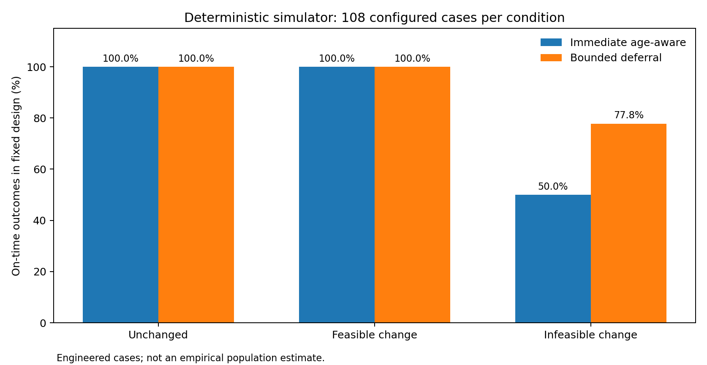
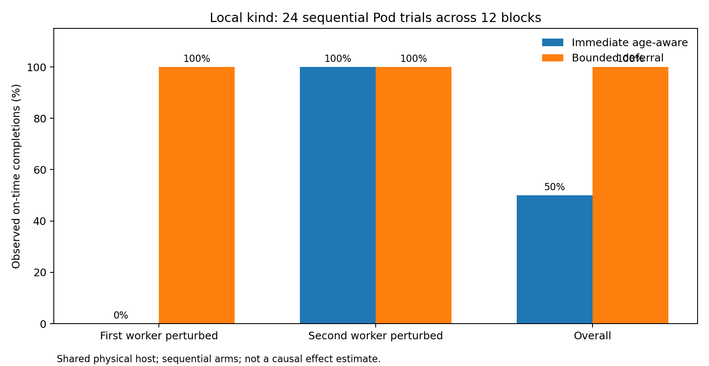

# EdgePilot v2: Is Bounded Waiting for Fresher Telemetry Worth the Deadline Cost?

**A controlled study of CPU-request placement under stale observations in edge–cloud-style scheduling**

**Status:** Research-paper *draft*, prepared 12 November 2026 for internal review and the 25 November release. **Not peer reviewed, not submitted, and not a claim of novel algorithms.**  
**Author / affiliation:** Add the verified author list, institution, and contact details before distribution.

## Abstract

Placement decisions made from stale resource telemetry may select nodes that no longer have enough schedulable capacity. Waiting for an updated observation can prevent such decisions, but consumes time that deadline-sensitive workloads cannot recover. EdgePilot v2 studies this information–latency tradeoff using (i) a deterministic discrete-event simulation with distinct measurement, delivery and actual resource states and (ii) a controlled local Kubernetes-in-Docker (*kind*) validation harness. The fixed synthetic sensitivity design consists of 324 matched cases, comprising 648 scheduling-policy runs. For the 108 cases whose capacity change made an old candidate infeasible, an immediate age-aware strategy completed 54/108 on time, versus 84/108 for bounded deferral; the two strategies both completed 108/108 when capacity was unchanged and 108/108 when capacity changed but stayed feasible. In a separate single-host kind study, the two policies were executed in 24 sequential Pod trials across 12 worker-balanced blocks and three fixed runs. The immediate age-aware arm completed 6/12 observed jobs within deadline, compared with 12/12 for bounded deferral, which waited an additional 1.863 seconds on average. All six differences occurred under one worker-perturbation stratum, emphasizing the role of deterministic selection and controlled capacity boundaries. The simulator demonstrates a mechanism under predeclared conditions; the kind pilot supports its plausibility but does not establish a randomized causal or general performance effect. The central conclusion is conditional: waiting can be beneficial when useful updated telemetry arrives before the remaining execution budget is exhausted, while otherwise increasing latency or exposure to disruption.

**Keywords:** cluster scheduling; stale telemetry; deadline-aware scheduling; value of information; Kubernetes; CPU requests; bounded deferral; reproducibility.

## 1. Introduction

Resource-aware schedulers must select an execution site based on information that may already be outdated when a workload arrives. Actual available capacity can change between telemetry measurement, delivery and placement. For jobs with deadlines, choosing a stale-feasible but presently infeasible node can cause a long unschedulable wait; asking for fresher data can reduce that risk but itself consumes slack. This tradeoff is especially relevant in dynamic environments, although the present project deliberately validates only controlled CPU-request changes on a local cluster rather than a physical edge network.

Prior cluster scheduling work emphasizes placement quality, scheduling latency and consistency of shared state. Omega studies shared-state scheduling and concurrent changes to cluster information [1]; Sparrow investigates low-latency distributed scheduling [2]; Firmament investigates fast placement optimization at scale [3]. Deadline risk is also related to latency tail concerns in distributed systems [4]. These established works motivate the problem but do not, by themselves, establish novelty for EdgePilot's particular policy or experimental implementation.

**Research question.** Under which specified telemetry delivery delays, capacity transitions, and deadline budgets does bounded waiting improve observed on-time completion compared with dispatching immediately using an age-aware node choice?

**Contribution scope.** EdgePilot v2 provides a reproducible reference implementation and a tightly controlled experimental study—not a new Kubernetes scheduler plugin, network-telemetry field deployment, or proof of broad system-level improvement. The project maintains a separate frozen claims ledger (`RESEARCH_CLAIMS.md`) to prevent reported outcomes from outrunning their evidence.

## 2. System model and scheduling alternatives

Each workload has an arrival time `a`, an absolute deadline `d`, a requested CPU quantity `r`, and execution duration `e`. For node `i`, telemetry reports CPU capacity and reserved CPU at measurement time `m_i`, but the report may become visible to the policy only at receipt time `q_i ≥ m_i`. At decision time `t ≥ q_i`, observed sample age is `t − m_i`. The scheduler's received samples are distinct from the environment's actual capacity state. No policy is allowed to see future or not-yet-delivered samples.

The placement feasibility requirement in the kind experiments concerns **Kubernetes CPU requests**, not instantaneous CPU usage. Kubernetes accounts for requested resources when finding nodes to host Pods, even when containers use little CPU [5]. Consequently, a sleeping Pod with a large request is an appropriate *reservation/admission* test but not an experiment in actual CPU saturation.

Four policies are implemented for the broader simulator and earlier pilots: immediate greedy selection using reported capacity (with a deterministic tie rule), an age-penalized immediate choice, bounded deferral, and uncertainty-aware admission. The *final primary comparison* is deliberately narrower: **immediate age-aware versus bounded deferral** under common prescribed initial information. Bounded deferral allows waiting only within a maximum deferral cap and the known time left after accounting for expected execution and dispatch overhead. A later observation is valuable only if it is actually delivered while the job remains schedulable before its deadline.

The conceptually necessary timing condition for a successful defer-and-place outcome is:

`waiting + decision/dispatch overhead + startup + execution ≤ remaining deadline budget`.

This is a feasibility requirement, not an estimated optimal waiting policy. Kubernetes startup and image-cache effects mean the realized end-to-end duration may differ from the simplified simulator's configured dispatch and execution times.

## 3. Implementation and provenance

### 3.1 Deterministic simulation

A discrete-event simulation models workload arrival, CPU reservation and release, telemetry measurement and delayed delivery, dispatch, completion and selected reliability disruptions. Its core validation separates actual node state from observed telemetry and tests information-availability guards, resource accounting and deadline outcomes. Earlier stress studies showed that waiting can hurt under contention and node outages; those unfavorable outcomes remain part of the release's evidence record.

### 3.2 Kubernetes validation environment

The user-operated test cluster uses Kubernetes v1.37.0, provisioned with `kind` on Windows through Docker Desktop and WSL 2. One control-plane and two worker nodes reported Ready. Both worker nodes are Docker-backed containers sharing the same physical computer; they are **not** independently provisioned edge machines [6]. Workloads are created only after explicit opt-in in a designated validation namespace and are cleaned up between sequential trials.

The policy harness captures an earlier node/Pod-request snapshot, places a temporary **200 millicore** reservation on a prescribed worker, then records a later snapshot. It verifies a near-capacity request-feasibility boundary before attempting the target workload. The immediate age-aware arm must act on its initially delivered observation; bounded deferral may wait and obtain a subsequent actual API observation. Both policies' initial observations are held equal-age within their trials. Actual Kubernetes placement is completed by the **default kube-scheduler plus a node selector**, not by a replacement scheduler [7]. The container executes `sleep`, so request feasibility is tested separately from CPU execution performance.

### 3.3 Fixed experimental design

The final synthetic matrix is a 324-case fixed factorial, with 108 cases per capacity-change class: unchanged, changed-but-still-feasible, and changed-to-infeasible. The implemented design varies the perturbed worker, telemetry delivery delay, workload deadline, waiting cap and known dispatch overhead; both policies receive the same initial observations and external event schedule for each synthetic pair. This is *engineered stress coverage*, not an independently sampled workload population.

The final kind evidence comprises three predeclared runs with seeds `20261116`, `20261117`, and `20261118`. Each run contains four two-policy blocks with alternating worker perturbation, for **24 sequential Pod trials and 12 blocks**. Although seeds differ, displayed policy orders may coincide; they must not be represented as independent random assignments. The two policy trials in a block are not literally simultaneous or physically identical.

### 3.4 Reproducibility and integrity controls

A complete Python test suite passed **525/525 tests** on the user's Windows environment at the Phase 3 checkpoint. The offline release gate independently reproduced the 324 synthetic cases and verified the 24 Kubernetes trial records against previously saved traces and pooled reports. It also computed a new checksum inventory for raw Kubernetes traces. Those hashes were first attested at this gate; they do **not** establish immutability before that date. The successful audit verifies consistency of saved evidence, not the scientific adequacy of the experimental design.

## 4. Results

### 4.1 Fixed deterministic simulation

| Capacity change condition | Matched cases | Immediate age-aware on-time | Bounded deferral on-time |
|---|---:|---:|---:|
| Unchanged | 108 | 108/108 | 108/108 |
| Changed, remains feasible | 108 | 108/108 | 108/108 |
| Changed, becomes infeasible | 108 | 54/108 | 84/108 |
| **Total** | **324** | **270/324** | **300/324** |

The difference in the infeasible-change stratum is **30/108 configured cases** (27.78 percentage points). The gains come from the specified information-arrival/capacity boundary combinations; no population significance test is appropriate for this deterministic enumeration. In the other two strata, waiting does not improve the binary on-time metric and adds approximately half a simulated second of intentional delay per case on average. The earlier broader reliability study also observed negative bounded-deferral effects in some disturbance conditions. These negative results are essential to a balanced conclusion.

### 4.2 Controlled local Kubernetes observations

| Perturbed worker stratum | Blocks | Immediate age-aware on time | Bounded deferral on time |
|---|---:|---:|---:|
| Lexically first worker | 6 | 0/6 | 6/6 |
| Second worker | 6 | 6/6 | 6/6 |
| **Combined** | **12** | **6/12** | **12/12** |

Mean intentional bounded waiting was **1.863 seconds** per trial across the 12 blocks. The six observed policy differences all arose when the first worker was perturbed; the other six blocks were ties. Earlier retrospective audits found that the naive greedy tie-break selected an infeasible worker on 8/16 common-input traces, while reverse tie-breaking shifted those failures to the opposite perturbation stratum. This demonstrated a meaningful selection-order confound and motivated the stronger immediate age-aware comparator used here.

The audit categorized two distinct events: fresh-reference infeasible selection and *TimedOutObservation*, meaning the Pod did not reach a successful observed terminal state before the configured deadline. A timeout does **not** prove that Kubernetes would never admit or complete the Pod. In earlier trials, Kubernetes `Insufficient cpu` events supported the CPU-request mechanism independently, but the present paper does not reclassify every timeout as permanent failure.

### 4.3 Initial cold-start and interpretation

The first single-Pod validation had a 25.25-second observed completion with approximately 21 seconds from Kubernetes object creation to container start, while ten subsequent smoke trials had a median 4.97-second end-to-end duration and one-second reported creation-to-container-start duration. Those warm observations are descriptive and small-sample; cache state, cluster loading and clock/reporting granularity can affect startup measurement. This variability reinforces why remaining deadline slack must include startup overhead rather than considering only the sleeping workload duration.

## 5. Discussion

The final fixed synthetic study and controlled kind trials are consistent with a **conditional value-of-freshness** mechanism. When the initially eligible worker loses sufficient schedulable CPU-request capacity and an updated observation can arrive before deadline slack is exhausted, bounded waiting may avoid an infeasible worker selection. If neither capacity nor feasibility changes, the same waiting delays completion without improving the on-time indicator. Thus, the rational comparison is not “always wait versus always schedule”; it is whether expected information gain justifies consuming deadline budget.

The worker-stratified kind observations further warn against interpreting aggregate figures in isolation. The immediate strategy's weakness was exposed entirely in one deterministic worker perturbation stratum. Controlled rotation and replay helped identify this confound but did not eliminate the non-simultaneity of live sequential arms. A change from 6/12 to 12/12 is a **descriptive difference in this test protocol**, not a 50-percentage-point causal treatment effect applicable to other clusters. No inferential p-value or confidence interval is reported for these sequential shared-host observations.

The project's practical utility is as an auditable platform for reasoning about stale information, CPU-request admission and deadline accounting. It is not yet evidence that a production scheduler should defer jobs under realistic multi-host outages or natural telemetry delays.

## 6. Threats to validity and limitations

**Internal validity:** Policy arms execute sequentially; both act within the same prescribed treatment but not identical actual Pod microstates. Fixed worker names, tie-breaking and potential cache effects can influence outcomes. A finite observation deadline can censor a Pod that might later complete.

**Construct validity:** Kubernetes request allocations are not CPU utilization, and sleeping Pods do not measure throughput, power draw, throttling or actual compute saturation. The lab varies request reservations, not measured real-world network telemetry staleness.

**External validity:** `kind` worker nodes share one host. No physically independent edge/cloud machines, WAN links, production scheduler, energy measurements or independent workload traces were evaluated.

**Statistical validity:** The deterministic matrix is not a random sample. Twelve sequential kind blocks on shared infrastructure are small, dependent observations. This manuscript makes no population efficacy, statistical-significance or robust causal claims.

**Reproducibility limits:** The Phase 3 gate replays and audits records, but checksums were first taken at that checkpoint. Not every dependency/environment aspect is pinned in a full immutable image. An independent replication on separate hardware remains to be done.

**Novelty boundary:** A literature review beyond the references below and expert evaluation are needed to determine novelty. The work is not peer reviewed.

## 7. Conclusion

EdgePilot v2 provides a reproducible experimental framework for the deadline-sensitive value-of-freshness tradeoff. The final synthetic matrix isolates cases where a timely updated resource observation avoids a stale-infeasible placement. A small controlled Kubernetes feasibility experiment records compatible observations, but the outcome remains dependent on worker perturbation and the sequential single-host setup. The defensible finding is **conditional**: bounded deferral can help when additional telemetry is informative and arrives with sufficient deadline slack; otherwise it adds waiting and may be harmful under system disruption. Larger, independently hosted, prospectively randomized experiments would be required before deployment or generalized performance claims.

## References

[1] M. Schwarzkopf, A. Konwinski, M. Abd-El-Malek, and J. Wilkes. “Omega: Flexible, Scalable Schedulers for Large Compute Clusters.” *EuroSys*, 2013. https://research.google/pubs/omega-flexible-scalable-schedulers-for-large-compute-clusters/

[2] K. Ousterhout, P. Wendell, M. Zaharia, and I. Stoica. “Sparrow: Distributed, Low Latency Scheduling.” *SOSP*, 2013. https://amplab.cs.berkeley.edu/publication/sparrow-distributed-low-latency-scheduling/

[3] I. Gog, M. Schwarzkopf, A. Gleave, R. N. M. Watson, and S. Hand. “Firmament: Fast, Centralized Cluster Scheduling at Scale.” *OSDI*, 2016. https://research.google/pubs/firmament-fast-centralized-cluster-scheduling-at-scale/

[4] J. Dean and L. A. Barroso. “The Tail at Scale.” *Communications of the ACM*, vol. 56, 2013. https://research.google/pubs/the-tail-at-scale/

[5] Kubernetes Documentation. “Resource Management for Pods and Containers.” https://kubernetes.io/docs/concepts/configuration/manage-resources-containers/

[6] kind Documentation. “kind — Kubernetes in Docker.” https://kind.sigs.k8s.io/

[7] Kubernetes Documentation. “Scheduling Framework.” https://kubernetes.io/docs/concepts/scheduling-eviction/scheduling-framework/

## Reproducibility appendix

The required source paths, frozen commands, environment, audit output and preservation guidance are specified in `REPRODUCIBILITY.md`. The principal implementation sources are `research/models.py`, `research/policies.py`, `research/advanced.py`, `research/reliability.py`, `research/phase2_sensitivity.py`, `research/kube_wait_value.py`, `research/phase2_real_report.py`, and `research/release_audit.py`. The corresponding preserved evidence consists of `research_outputs/phase2_sensitivity_01`, three `research_outputs/kubernetes/wait_value_0*` runs, `research_outputs/kubernetes/phase2_real_report_01`, and `research_outputs/release_audit_phase3_01`.
